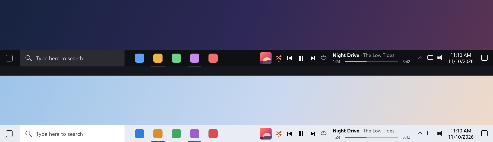
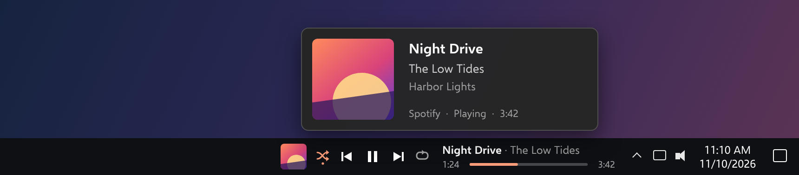
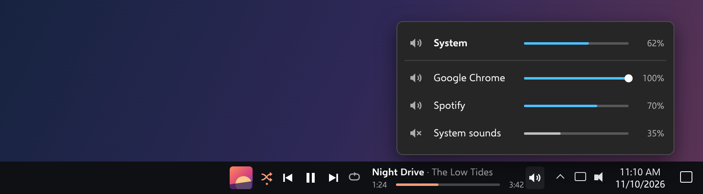
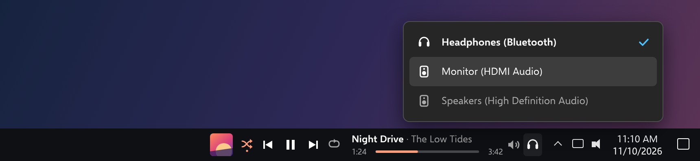
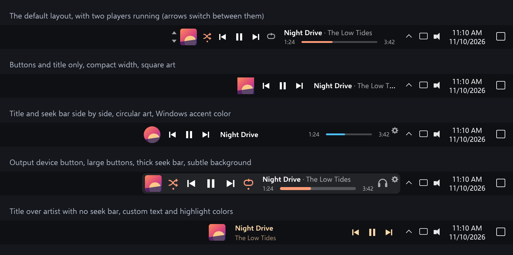
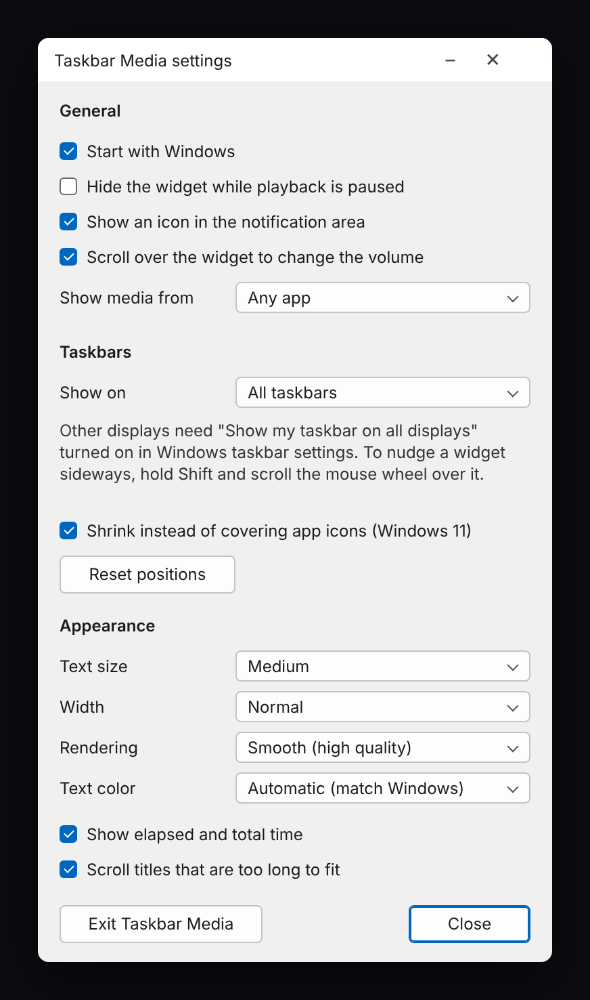

# Taskbar Media

A now-playing widget that sits on the Windows taskbar, immediately left of the
notification area (tray icons and clock).

Rest the mouse on it for a closer look at what is playing:

The speaker button opens a volume mixer for the system and each app:

The optional output device button switches between speakers and headphones:

Nearly everything can be rearranged, hidden or restyled:

From left to right:

- Up / down arrows to switch player (greyed out with a single player)
- Album art; click it to bring up the app that is playing
- Shuffle, previous, play/pause, next, repeat (shuffle and repeat are greyed
  out when the player does not support them)
- Title and artist over a seek bar with elapsed / total time (click or drag)
- A speaker button that opens the volume mixer

It uses Windows' own media session API, so it works with anything that shows
up in the Windows media flyout: Spotify (desktop and Store versions), browsers,
Media Player, foobar2000, and so on. The widget hides itself when nothing is
playing and when a full-screen app is in front. Titles that are too long to
fit scroll. The widget keeps clear of app icons: on Windows 10 the taskbar's
app area is narrowed to make room for it, and on Windows 11 the widget shrinks.

## Install

1. Download `TaskbarMedia.exe` from the
   [latest release](https://github.com/austin-72/taskbar-media/releases/latest)
   and put it somewhere it can stay, for example a `TaskbarMedia` folder in
   Documents.
2. Run it. There is no installer and there are no other files.
3. The exe is not code-signed, so the first time Windows may show "Windows
   protected your PC". Choose **More info**, then **Run anyway**.

To check a download, compare its SHA-256 with the one in the
`TaskbarMedia.exe.sha256` file attached to the same release. In PowerShell,
in the folder with both files, this prints `True` when they match:

    (Get-FileHash TaskbarMedia.exe).Hash -eq (Get-Content TaskbarMedia.exe.sha256).Split()[0]

**Updating:** right-click the widget and choose Exit, replace the exe with
the new one, and run it. Your settings are kept. If you put the new exe
somewhere else instead, un-tick and re-tick "Start with Windows" in Settings
so that Windows starts the new copy (Settings says when another copy is the
one set to start; if the old copy is deleted, the setting moves over by
itself).

**Removing:** turn off "Start with Windows" in Settings, exit, and delete the
exe. To remove every trace, also delete the registry key
`HKCU\Software\TaskbarMedia` and the folder `%LOCALAPPDATA%\TaskbarMedia`.

Task Manager shows two TaskbarMedia processes. That is intended: a tiny one
watches the widget and starts it again if it ever crashes or stops
responding. Starting the exe a second time opens the settings window of the
copy that is already running.

## Use

- Right-click the widget or use the tray icon for settings (a settings
  button can be added to the widget in Settings, Layout)
- Mouse wheel over the widget changes the player's own volume
- Click the speaker button for a mixer with the system volume and every
  app's own volume
- Click the title to copy "Artist - Title"
- With several players running, use the arrows left of the album art, or
  right-click and choose one under Player ("Automatic" hands the choice back)
- The right-click menu also copies the track name and opens the volume mixer
  and output device list
- Right-click and choose Output device to switch speakers / headphones, or
  add the output button to the widget in Settings, Layout
- Shift + mouse wheel over a widget nudges it left or right
- With a popup open: Up / Down move through it, Enter chooses, Esc closes;
  in the mixer Left / Right change the volume and Space or M mutes

## Settings

- **General**: start with Windows, hide while paused, tray icon, update
  check, Spotify only, which taskbars to show on, keep clear of app icons
- **Layout**: which items show and in what order (with the title and seek
  bar stacked, side by side, or on their own), presets, a separate layout
  for other displays, button size and spacing, shuffle stacked above repeat,
  and whether unusable buttons are greyed out or hidden
- **Appearance**: text size, text width, what the text shows, font, text
  color, rendering (smooth or sharp), highlight color, custom colors, album
  art shape, seek bar thickness, background, times, scrolling titles, hover
  card
- **Behavior**: what the mouse wheel, a click on the album art, a click on
  the title, and the output device button do, and which volume the speaker
  icon reflects
- **More**: export, import or reset all settings; version and releases;
  the crash log folder; "Save pictures of the widget", which writes PNG
  images of the widget and its popups to a `pictures` folder beside the exe

A live preview at the top of the settings window shows the result as you go,
the layout list can be reordered by dragging, and presets (Default, Minimal,
Compact, Everything, Classic) give a starting point. Ctrl+Tab moves between
the tabs and Esc closes the window.

If the widget ever crashes or stops responding it is restarted, and a line
is written to `%LOCALAPPDATA%\TaskbarMedia\crash.log`.

Requires Windows 10 (1809 or later) or Windows 11, 64-bit, with the taskbar at
the bottom or top of the screen. Taskbars on other displays exist only when
"Show my taskbar on all displays" is on in Windows taskbar settings.

## Known limits

- A taskbar at the left or right edge of the screen is not supported; the
  widget stays hidden there.
- Keeping clear of app icons works on the main taskbar of Windows 10 and on
  Windows 11. On Windows 10's taskbars on *other* displays, and with tools
  that replace the Windows 11 taskbar with the old one (ExplorerPatcher,
  StartAllBack), the widget can cover the last app buttons when the taskbar
  is full; nudge it with Shift + mouse wheel or pick a narrower layout.
- Two tabs or windows of the same browser are one player to Windows' own
  media controls, and so to the widget.
- The mouse wheel changes the player's own volume when Windows lists that
  player in its volume mixer on the current output device; otherwise it
  changes the system volume (Windows then shows its own volume display).
- The mixer and the device list show as many rows as fit on the screen and
  say how many more there are.
- A player picked by hand is followed until it closes; the choice is not
  remembered across restarts.
- With several other displays, all of their widgets share one sideways
  nudge. "Show on one display" identifies the display by its Windows
  number, which can change when displays are re-plugged.
- Changing the output device does not change the separate "communications"
  device that call apps use.
- Right-to-left Windows layouts are untested.
- Windows 11 support has had less testing than Windows 10.

## Switching output devices

Windows has no official way for an app to change the default output device.
Like other switchers, this uses an undocumented Windows interface that has
been stable since Windows 7. If a Windows update ever changes it, switching
shows "Could not switch output" and everything else keeps working.

## Update check

Unless turned off in settings, the app asks GitHub's public API a few times a
day for this repository's latest release number. Nothing else is sent, and
nothing is downloaded or installed: a newer version only adds a dot on the
widget and a menu entry that opens the releases page.

## Build

    cargo build --release
    cargo test

Building on Windows needs Rust 1.85 or later and Visual Studio Build Tools
with the "Desktop development with C++" workload (the MSVC linker and the
Windows SDK, for `rc.exe`). Each push is also tested and built by GitHub
Actions, and publishing a release on GitHub attaches a freshly built
`TaskbarMedia.exe` and its SHA-256 checksum to it. See
[CONTRIBUTING.md](CONTRIBUTING.md) for more.

Settings live in `HKCU\Software\TaskbarMedia`; "Start with Windows" adds a
value under `HKCU\Software\Microsoft\Windows\CurrentVersion\Run`.

## Testing

[docs/TESTING.md](docs/TESTING.md) is a checklist for trying a new build.

## About the screenshots

The pictures on this page are drawn from the widget's layout code with an
invented track, not captured from a running PC, so fonts and spacing can
differ slightly from the real thing.

## License

[MIT](LICENSE)
