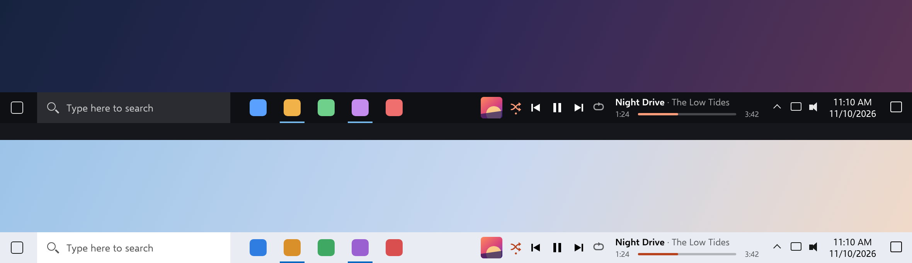
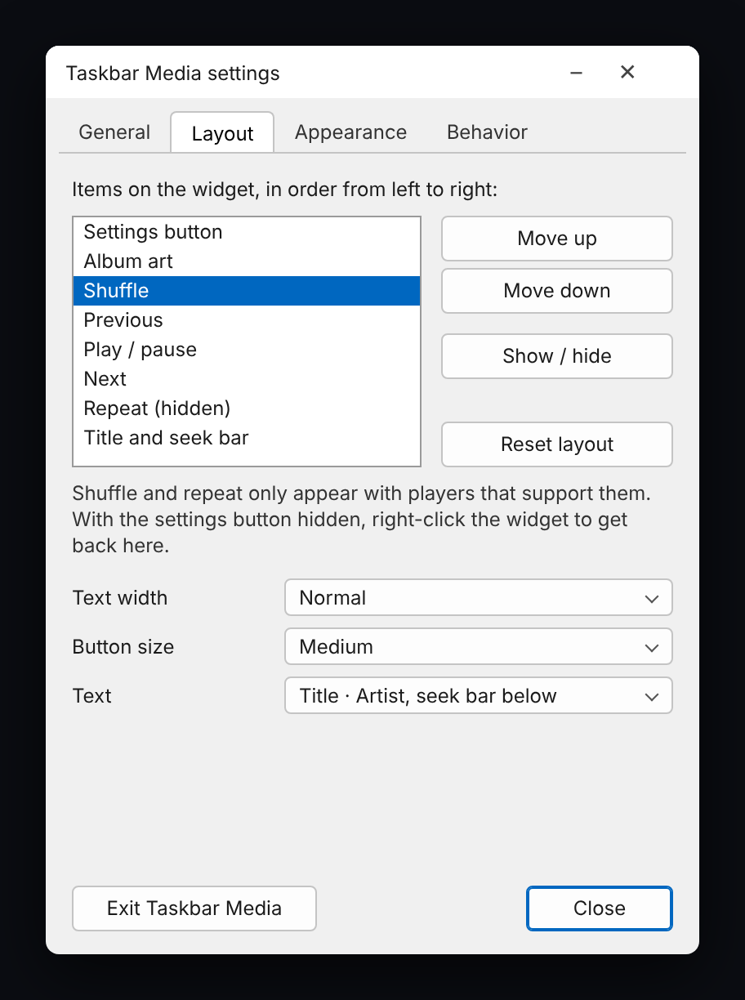

# Taskbar Media

A now-playing widget that sits on the Windows taskbar, immediately left of the
notification area (tray icons and clock).

From left to right:

- A small settings button
- Album art; click it to bring up the app that is playing
- Shuffle, previous, play/pause, next, repeat (shuffle and repeat only when
  the player supports them)
- Title and artist over a seek bar with elapsed / total time (click or drag)

It uses Windows' own media session API, so it works with anything that shows
up in the Windows media flyout: Spotify (desktop and Store versions), browsers,
Media Player, foobar2000, and so on. The widget hides itself when nothing is
playing and when a full-screen app is in front. Titles that are too long to
fit scroll. The widget keeps clear of app icons: on Windows 10 the taskbar's
app area is narrowed to make room for it, and on Windows 11 the widget shrinks.

## Use

Run `TaskbarMedia.exe`. There is no installer and no other files.

- Click the gear, right-click the widget, or use the tray icon for settings
- Mouse wheel over the widget changes the player's own volume
- Click the title to copy "Artist - Title"
- With several players running, right-click and choose one under Player
- Shift + mouse wheel over a widget nudges it left or right

## Settings

- **General**: start with Windows, hide while paused, tray icon, update
  check, Spotify only, which taskbars to show on, keep clear of app icons
- **Layout**: which items show and in what order, text width, button size,
  and what the text shows
- **Appearance**: text size, font, text color, rendering (smooth or sharp),
  highlight color, album art shape, seek bar thickness, background, times,
  scrolling titles
- **Behavior**: what the mouse wheel, a click on the album art, and a click
  on the title do

Requires Windows 10 (1809 or later) or Windows 11, 64-bit, with the taskbar at
the bottom or top of the screen. Taskbars on other displays exist only when
"Show my taskbar on all displays" is on in Windows taskbar settings.

## Update check

Unless turned off in settings, the app asks GitHub's public API a few times a
day for this repository's latest release number. Nothing else is sent, and
nothing is downloaded or installed: a newer version only adds a dot on the
gear and a menu entry that opens the releases page.

## Build

    cargo build --release

Building on Windows needs the MSVC toolchain and Windows SDK (for `rc.exe`).
Each push is also built by GitHub Actions, and publishing a release on GitHub
attaches a freshly built `TaskbarMedia.exe` to it.

Settings live in `HKCU\Software\TaskbarMedia`; "Start with Windows" adds a
value under `HKCU\Software\Microsoft\Windows\CurrentVersion\Run`.

## License

[MIT](LICENSE)
