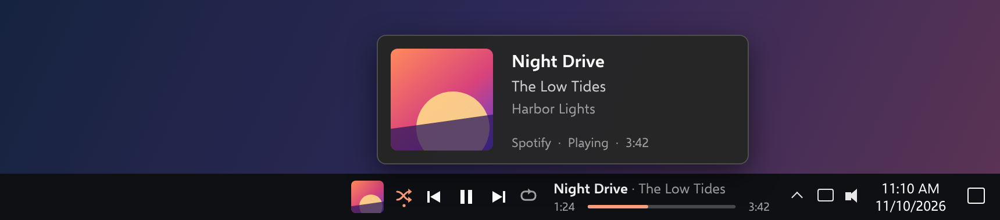
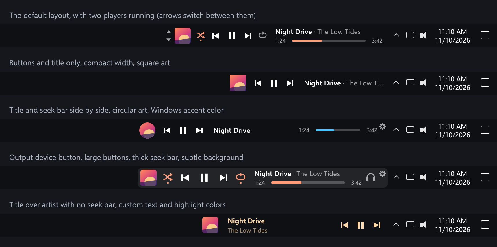

# Taskbar Media

A now-playing widget that sits on the Windows taskbar, immediately left of the
notification area (tray icons and clock).

Rest the mouse on it for a closer look at what is playing:

Nearly everything can be rearranged, hidden or restyled:

From left to right:

- Up / down arrows to switch player, when more than one app is playing
- Album art; click it to bring up the app that is playing
- Shuffle, previous, play/pause, next, repeat (shuffle and repeat only when
  the player supports them)
- Title and artist over a seek bar with elapsed / total time (click or drag)

It uses Windows' own media session API, so it works with anything that shows
up in the Windows media flyout: Spotify (desktop and Store versions), browsers,
Media Player, foobar2000, and so on. The widget hides itself when nothing is
playing and when a full-screen app is in front. Titles that are too long to
fit scroll. The widget keeps clear of app icons: on Windows 10 the taskbar's
app area is narrowed to make room for it, and on Windows 11 the widget shrinks.

## Use

Run `TaskbarMedia.exe`. There is no installer and no other files.

- Right-click the widget or use the tray icon for settings (a settings
  button can be added to the widget in Settings, Layout)
- Mouse wheel over the widget changes the player's own volume
- Click the title to copy "Artist - Title"
- With several players running, use the arrows left of the album art, or
  right-click and choose one under Player ("Automatic" hands the choice back)
- Right-click and choose under Output device to switch speakers / headphones,
  or add the output button to the widget in Settings, Layout
- Shift + mouse wheel over a widget nudges it left or right

## Settings

- **General**: start with Windows, hide while paused, tray icon, update
  check, Spotify only, which taskbars to show on, keep clear of app icons
- **Layout**: which items show and in what order (with the title and seek
  bar stacked, side by side, or on their own), a separate layout for other
  displays, text width, button size, and what the text shows
- **Appearance**: text size, font, text color, rendering (smooth or sharp),
  highlight color, custom colors, album art shape, seek bar thickness,
  background, times, scrolling titles, hover card
- **Behavior**: what the mouse wheel, a click on the album art, a click on
  the title, and the output device button do
- **More**: export, import or reset all settings; version and releases

Requires Windows 10 (1809 or later) or Windows 11, 64-bit, with the taskbar at
the bottom or top of the screen. Taskbars on other displays exist only when
"Show my taskbar on all displays" is on in Windows taskbar settings.

## Switching output devices

Windows has no official way for an app to change the default output device.
Like other switchers, this uses an undocumented Windows interface that has
been stable since Windows 7. If a Windows update ever changes it, switching
shows "Could not switch output" and everything else keeps working.

## Update check

Unless turned off in settings, the app asks GitHub's public API a few times a
day for this repository's latest release number. Nothing else is sent, and
nothing is downloaded or installed: a newer version only adds a dot on the
gear and a menu entry that opens the releases page.

## Build

    cargo build --release

Building on Windows needs the MSVC toolchain and Windows SDK (for `rc.exe`).
Each push is also built by GitHub Actions, and publishing a release on GitHub
attaches a freshly built `TaskbarMedia.exe` to it.

Settings live in `HKCU\Software\TaskbarMedia`; "Start with Windows" adds a
value under `HKCU\Software\Microsoft\Windows\CurrentVersion\Run`.

## About the screenshots

The pictures on this page are drawn from the widget's layout code with an
invented track, not captured from a running PC, so fonts and spacing can
differ slightly from the real thing.

## License

[MIT](LICENSE)
